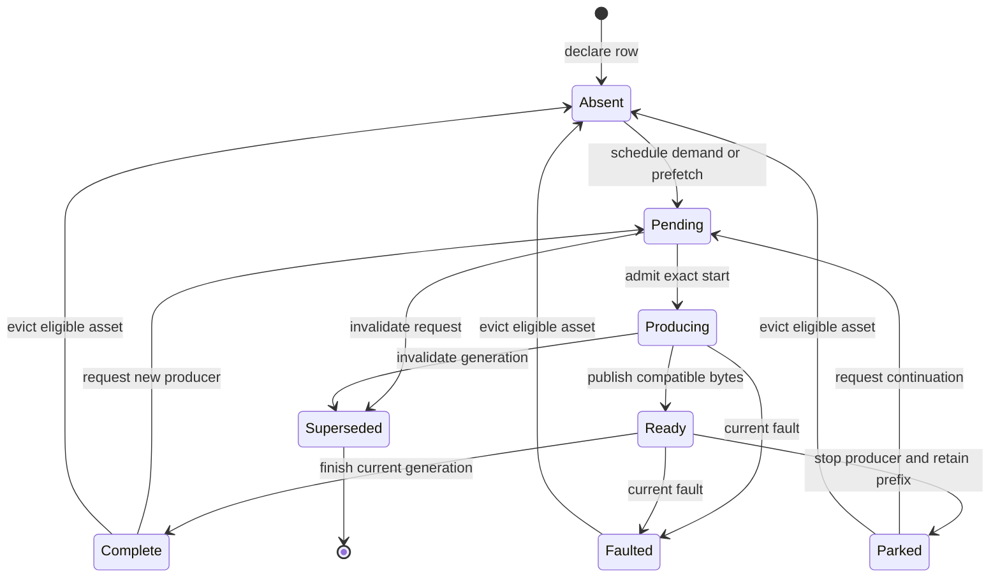

# Queue row ownership

## Baseline

The conversion starts at `55c9a4a77e4b50da7938a5c93a88bdff1ccb8c7e`, with core pinned at `ae276c4e85f650c3da2c6c3ce62b721ab87f5839`. Keep the static queue rules in [Sonos full queue](sonos-full-queue.md) and the seek rules in [Navigation invariants](navigation-invariants.md). I1–I6 in the repository guidance remain the acceptance contract.

## Current ownership inventory

| State and transition | Code and calling thread | Current ordering |
| --- | --- | --- |
| No playlist generation → candidate snapshot → known playlist or rejected candidate → confirmed clear or replacement | Room worker, `selectPath`, `acceptSnapshot`, `reconcileWindow`, `run` | Snapshot rereads, pending selections and edit fences, occurrence tokens, repeat and shuffle policy |
| Window slot → deferred static row → speaker queue insertion → retired route | Room worker, `QueueWindow::reconcile`, `makeRow`, `reconcileWindow`, `release`; HTTP route lookup in `Route::serve` | Token, epoch and revision, Browse and UpdateID verification, route mutex, revoke by epoch |
| Start requested → deferred metadata → admitted relay, stream handoff, or discarded request | Core command callback `received`; room worker `beginSelection`, `selectPath`; decoder callback `QueueRoom::decoder` | Request serial, deferred-start atomic, source maps under `sourceMutex`, cancellation occurrence, native immutable download identity and legacy unopened-header guard |
| No demand → request queued → activation claimed → producing → published → observed/retired | HTTP `LazyItem::resolve`; room worker `activateLazy`, `arbitrateSelection`, `advanceSelections`, `selectionPublished`, `observe` | Lazy mutex and connected-reader set, index-keyed selection, generation lower bound, exact own-command request serial, FIFO selection queue, observed stream acknowledgement |
| Source registered → descriptor pending → boundary → writing exact or bounded audio; pending estimated audio → sealed publication; bounded audio → continuation | Core callbacks `sourceIdentity`, `trackDescriptor`, `trackBoundary`, `write`; storage worker `append`, `appendEstimated`, `publishEstimated`, `continuationAfter`; `Store::create/publish` | Storage job FIFO, occurrence-scoped records, sink mutex and store mutex; pending publication supersession, separate continuation offsets |
| New producer → paired alias with unchanged WAV, verified interior attach, or fresh production | Storage worker `trackBoundary`, `append`; room worker `append` and `reconcileWindow` | Source URL and token, rendered format and source length, origin and prefix coverage, conversion warm-up and PCM overlap; audible alias and retirement checks |
| Producing → finished, parked reusable prefix, interrupted, cancelled, source fault or storage fault | Core end and flush callbacks; storage worker `finish`, `flush` jobs, `Item::finish/park/interrupt/cancel`; room worker `append`, `roomFault` | Captured flush occurrence, cancelled-source watermark, store mutex and reader notification. Current and room-wide storage failures retain their existing failure paths |
| Declared absent → first contract bound; equivalent reproduction → ready; replacement → new route when coordinates disagree | Room worker `append`, `reconcileWindow`, `LazyItem::publish/replace` | Room, rate, promise kind and exact resolved length checks; lazy mutex, cancellation check and room binding. A deferred declaration resolves its byte contract when the first compatible production declares it |
| Ready → HTTP metadata view or admitted response → body sends → close | HTTP request thread, `Route::serve`, `LazyItem::ready/resolve`, `Item::retainAudio`, `Reader::read` | Route and lazy mutexes; response lease acquired under eviction lock; reader progress under store lock. Metadata and HEAD do not pin audio |
| Resident → protected/unprotected → quota evicted → stale row normalized → lazy production | Storage work and store quota eviction; room worker `discardEvicted`, `trimHistory`, `observe`, `append`; HTTP `resolve` can discover eviction first | Finished, faulted or parked eligibility, active response count, protected window and current writer exclusion; conditional lazy reset compares the previous item |
| Navigation intent → prepared target → verified switch → audible acknowledgement | Room worker `command`, `reconcileWindow`, `observe`, `speakerCommand`; asynchronous renderer subscription updates feed observations | Ownership, topology, Browse and UpdateID boundaries, arbiter/outbox, observed target URI and ordinal, expected echoes, audible rather than decode-ahead clock authority |
| Shortened row → covered in-item seek, or replacement via insert/select/remove → deferred frame-zero history | Same room and storage workers; `reconcileWindow`, sink pairing and position clock, `SpeakerChanges::expectTrack` | Preserve live WAV through flush, verify actual landing, anchor clock at source origin, and arm the echo from the inserted row before selecting |
| Audible completion → successor or final stopped; external takeover/stop → abandon and revoke | Room worker `observe`, `externalStop`, `release` | Fresh renderer evidence, end position, expected transport and echo state, owned queue identity. Release cancels live routes and producers |
| History protection/retirement and saved queue maintenance | Storage worker `protectItems`, `releaseParent`; room worker `protectWindow`, `releaseWindowParent`, `pruneBackups` | Retain live aliases, quota protection, topology lease and final transport/playlist ownership verification before destruction |

## Proposed owner and state

Use a room-scoped owner for declarations, generation registrations, selected targets and published handles. Serialize decisions in short owner operations. HTTP and storage callers submit events with identity and receive immutable snapshots or leases. The room worker still executes speaker and LMS effects. No socket I/O, response wait, or storage write runs under the owner lock. If an effect completes asynchronously, return its reservation identity to the owner. Keep the renderer's transport and queue revision checks at the point of effect.

A declaration has a stable playlist generation, occurrence token, place, track identity and address. Its promise describes format, length policy and source coordinates. A lazy declaration carries a deferred length policy. The concrete byte contract is sealed once and retained over eviction. Compare future productions with that contract before serving bytes. Represent source coverage independently of the promised output length. A future declaration can promise the full track while its audio coverage starts at a later source frame. This round continues serving existing contiguous WAVs and uses a fresh address for a shortened-row replacement. A promoted replacement is a separate declaration at the same playlist place.

A generation identifies a row token, source identity, exact selection request serial, cancellation generation, and unique producer occurrence. Repeat, seek, retry and pairing create new production identities. A paired producer may extend a retained asset using a write lease after validation. Bytes already exposed by the asset remain immutable. A pending generation may coexist with a published asset. One generation is current for publication per row and one rendition is visible at its address. A response holds a lease on the specific asset selected when its body is admitted. The asset may also have producer leases or metadata references, with different lifetimes.

The diagram follows the active production. A retained asset can remain published during Pending or Producing. Retirement of a declaration removes future resolution authority and follows existing explicit cancellation behavior.

| Event | Guard and ordered effect |
| --- | --- |
| Demand, app selection, LMS navigation, restart, natural successor | Resolve from known playlist generation and the authoritative intent. Queue or join the index owner and preserve independent live HTTP demands. Use repeat-aware successor only for natural continuation |
| Start answer | Compare the exact pending serial and cancellation generation, token and source evidence before consuming the pending start. Late answers leave selection and publication unchanged |
| Producer progress or interior seek attach | Authenticate producer write lease, compare format, landing, coverage and overlap. Bind the audible clock to the selected producer and actual source origin. On failed verification, plan the established fallback |
| Publish | Compare-and-swap the current generation and expected prior published asset. Validate the sealed declaration before swapping. Wake compatible waiting readers after commit |
| Complete or fault | Compare generation before updating lifecycle or initiating room effects. Stale generation events cannot clear the rendition or stop a replacement. Report independent storage subsystem failure through its existing room path |
| Cancel or park | Invalidate admission and write authority for the matching generation. Retain an eligible reusable prefix and preserve existing explicit stop behavior and legacy shared-input retirement |
| HTTP open and close | Metadata lookup returns a snapshot. Body admission pins the selected asset atomically against eviction. Close releases that lease; progress changes the response cursor |
| Quota pressure | On the existing quota path reserve eligible storage under the same synchronization as body pinning. Commit absence only for the matching generation and asset; preserve any newer pending demand. Apply to parked, complete or faulted audio with no active pins |
| Navigation commit | Compare intent, request, target declaration and admitted generation. Route LMS commands from the reserved index and speaker commands from its verified URI and ordinal. Recheck transport authority at the write boundary. Register echo against the verified layout including any inserted row |
| Replacement | Stage a fresh declaration, verify insertion, reserve selection and then retire the old declaration. A newer intent requires rebasing from observed Browse state |
| Maintenance | Run history retirement and backup pruning independently of playback publication. Carry only the existing topology and final transport authorization to backup destruction |

I1 checks live demand through the index owner and output command order. I2 checks playlist-generation evidence before clear. I3 checks same-source frame-zero pairing before reproduction. I4 checks covered landings, including warm-up and overlap, against the retained rendition. I5 checks rewind authority and equivalence of the command target and committed selection. I6 checks that rejected verification chooses the fallback, and that only a genuine current room fault takes the room failure path.

## Known faults by missing rule

| Missing rule | Fault and competing actors | Existing fence or repair | Excluding transition |
| --- | --- | --- | --- |
| Exact admission | 1. Deep Back timed out and removed queue when the old natural producer consumed the replacement source prefix | Immutable native download bound to admitted track, shared stream retained for protocol and pacing | Start answer and source binding |
| Exact admission | 2. Repeat-wrap and app echo crossed audible index and decode-ahead identity | Repeat-aware successor, controller supersession and exact q+s serial | Demand and start answer |
| Matching cache identity | 3. Old eviction cleanup reset a newer lazy activation | Conditional reset of observed item | Quota pressure |
| Separate response lifetime | 4. Quota evicted a WAV during an admitted body response | Response lease under eviction lock | HTTP open and quota pressure |
| Matching cache identity | 5. App observation after response close treated a cache miss as a room fault | Recoverable eviction and observation-time normalization | Quota pressure and navigation commit |
| Exact admission | 6. Paired converted FLAC bypassed local identity publication and stranded final FIR frames | Source classification before pairing and producer publication | Start answer |
| Audible coordinates | 7. A previous clock gave a frame-zero WAV a nonzero origin | Clear stale origin at decoded frame zero | Producer progress |
| Audible coordinates | 8. Same-row seek inherited decode-ahead clock and restarted at zero | Audible source authority and separate index/rewind command reasons | Navigation commit and attach |
| Audible coordinates | 9. Pre-start status reported 17 s during a 16 s seek | Use post-decode status for the audible index and preserve explicit rewind authority | Producer progress and attach |
| Exact admission | 10. Native WAV input changed raw PCM publication behavior | Strip container and preserve negotiated representation | Start answer and publish |
| Separate producer lifetime | 11. Reusable prefixes occupied quota after their producers stopped | Park stopped prefixes and keep normal response protection | Cancel or park and quota pressure |
| Exact admission | 12. Removing shared-source guard let legacy q-before-header race | Keep existing 250 ms guard on the legacy path | Cancel or park and start answer |
| Independent maintenance | 13. Backup pruning wrote after takeover | Check coordinator and recheck transport immediately before destruction | Maintenance |
| Independent maintenance | 14. Backup repair increased cold SOAP topology reads | Reuse topology lease and preserve final transport verification | Maintenance |
| Matching cache identity | 15. Repeat-wrap appended a thirteenth row after eviction | Normalize the evicted binding and reuse its static URI | Quota pressure and publish |
| Exact admission | 16. Cancelled producer fault tore down a healthy replacement | Ignore non-storage faults through the captured cancellation occurrence | Complete or fault |
| Immutable byte contract | 17. SEEK-03 full WAV on suffix URI produced a declaration mismatch and room stop | Insert fresh compatible row, select once, then remove old row | Publish and replacement |
| Audible coordinates | 18. SEEK-03 suffix clock lost source origin, and covered suffix seeks could rebuild | Start fitted clock at source origin, retain covered audible suffix through flush and verify row-relative attach | Producer progress and attach |
| Exact navigation commit | 19. SEEK-03 switch registered an echo from the old layout and could send external stop | Arm echo against the verified inserted URI and ordinal | Navigation commit |
| Exact admission | 20. Pressure lane expected index 7 after seed 314159 step 87, while a truncated input and two q+s pairs preceded publication of index 8 | Standalone scheduling passed the seed. The captured log does not associate each start with a verified intended index | Demand, start answer and navigation commit. Replay needs the serial, intended target, and metadata result for both starts |

The FULLQ-01d decimator throughput failure is separate from the sixteen-fault inventory. Its core speed assertion and threshold stay as written.

## Conversion order

1. Introduce the owner and generation identities alongside existing paths. Move admission and replace the cancellation watermark and serial handoff when owner checks provide equivalent ordering. Preserve native immutable input, raw PCM conversion and the legacy shared-input guard.
2. Move lazy binding and HTTP lease acquisition, then cache eviction. Remove separate stale-binding resets, recovery sync points and replacement bookkeeping once owner outcomes cover the same transitions. Retain the response pin and store synchronization required to protect live bytes.
3. Transfer navigation reservation and commit. Remove historical echo authority once it is represented by the active reservation. Keep Browse/UpdateID and transport fences for external actors.
4. Route completion, fault and shortened-row replacement through owner comparisons. Remove supersession checks whose responsibility has moved. Keep recoverable mismatch fallback and actual source/clock validation.
5. Drive the production owner with ordered events. Replay each fault family and the pressure trace, then compare five baseline and five final lane runs, checking command counts, clock figures and SOAP calls. Run the final gate with the required consumer.
